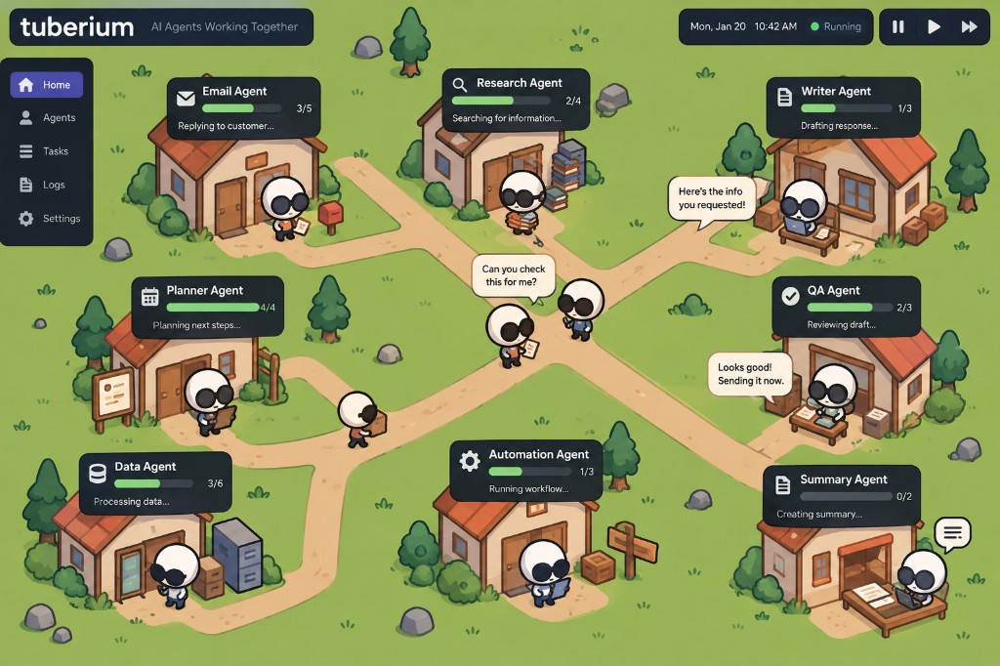

# Themes

Themes change the look, never what a system does or what you can see about it.

## Fixed in every theme

So control info never gets themed away:

- Permission badges: same icons and order in every theme. Only colors change.
- The progress bar and the "doing" line under every home.
- Approval requests, costs, errors and blocked messages.
- Status is never shown by color alone: always a word and an icon too.

## The five themes

| | Tuberian (default) | Business Professional | Factory | Jungle | Swamp |
|---|---|---|---|---|---|
| Vibe | Cozy village, silly but not too silly | Clean, serious, high-level work | Business meets industry | Very silly, for beginners | Silly, frogs |
| Homes | Cozy cottages, props outside that match the job | Clean circles with a monogram | Machines and workstations | Tree houses | Lily pads and stumps |
| Lines | Dirt paths | Thin lines, small arrows | Conveyor belts | Vines and rope bridges | Stepping-stone paths through reeds |
| Travelers | Round white critters in sunglasses | A small dot | Crates riding the belt | Animals swinging along | Frogs hopping |
| Message | Speech bubble with the message preview | Envelope | Crate with a paper | Leaf note | Fly in a bubble |
| File | Box or stack of papers | Document icon | Box | Coconut | Leaf parcel |
| Overseer home | Town hall, biggest building on the map | Larger circle, double ring | Control tower | Rock throne | Big log |
| You | Your house, with a mailbox for approvals | "You" avatar | Supervisor's office | Explorer's tent | Fishing dock |
| Palette direction | Grass green, warm wood, terracotta roofs; dark navy status cards, green progress bars | Navy, white, slate, one accent | Safety yellow, steel gray | Leaf greens, sunset orange | Murky teal, lily pink |

## Status words

| Status | Tuberian | Business | Factory | Jungle | Swamp |
|---|---|---|---|---|---|
| `idle` | Chilling | Idle | Standby | Napping | Sunbathing |
| `working` | Bubbling | Working | Running | On the hunt | Ribbiting |
| `traveling` | Heading over | In transit | Shipping | Swinging over | Hopping over |
| `waiting` | Waiting on you | Awaiting approval | Needs sign-off | Waiting on you | Waiting on you |
| `done` | Done! | Complete | Shipped | Got it! | Splash! Done |
| `failed` | Tripped up | Failed | Jammed | Stuck in the mud | Stuck in the muck |

## Characters by agent template

Each agent's `template` picks its character and title in the active theme.

| Template | Tuberian (critter + prop at home) | Business | Factory | Jungle | Swamp |
|---|---|---|---|---|---|
| `overseer` | megaphone, town hall | Director | Control tower | Lion | Big toad |
| `researcher` | stack of books | Research Analyst | Scanner | Owl | Heron |
| `scout` | spyglass, signpost | Scout | Drone | Spider monkey | Dragonfly |
| `writer` | laptop at a desk | Writer | Printing press | Parrot | Tree frog |
| `reviewer` | papers and a red pen | Reviewer | Inspection station | Elephant | Snapping turtle |
| `analyst` | charts on an easel | Analyst | Calculator unit | Chimpanzee | Salamander |
| `reader` | letter, mailbox | Inbox Manager | Intake hopper | Toucan | Newt |
| `sorter` | labelled crates | Coordinator | Sorting machine | Leafcutter ants | Crayfish |
| `planner` | clipboard, notice board | Planner | Blueprint table | Tortoise | Beaver |
| `cleaner` | mop and bucket | Data Specialist | Washer | Hippo | Catfish |
| `designer` | paint palette, easel | Designer | 3D printer | Peacock | Firefly |
| `poster` | flyers, notice post | Publisher | Shipping dock | Howler monkey | Bullfrog |
| `applier` | envelope stack, mailbox | Applications Manager | Mail chute | Hummingbird | Mudskipper |
| `trader` | briefcase, little vault | Trader | Vault | Jaguar | Otter |
| none | plain critter | Agent | Generic machine | Sloth | Plain frog |

The Tuberian critters need a name. Your call.

## Tuberian reference



The target look for the default theme: a village map, houses as homes, dirt paths as lines, critters walking the paths with speech bubbles and boxes, a dark status card above every house (icon, name, progress bar with step count, what it's doing). Drag this image into Cursor whenever you work on the look.

## Theme pack shape

A theme is a data file in `frontend/src/themes/`. Components read it; they contain no theme-specific code.

```ts
type ThemePack = {
  id: "tuberian" | "business" | "factory" | "jungle" | "swamp";
  name: string;
  vars: Record<string, string>;          // CSS variables: colors, fonts, radii, line widths
  home: "cottage" | "circle" | "machine" | "treehouse" | "lilypad";
  line: "path" | "plain" | "conveyor" | "vine" | "reeds";
  skins: Record<string, Skin>;           // keyed by template, plus "overseer", "you" and "default"
  carrying: { message: string; file: string };
  statusWords: Record<AgentStatus, string>;
};

type Skin = { title: string; art: string };
```

## Art plan

1. **Now:** emoji placeholders as `art` (🦉 🦜 🐸 ⚙️ 🏠). Free, instant, good enough to build and demo every theme.
2. **Later:** swap in real images by changing `art` to an image path. Draw them in Figma, commission them, or generate them. Nothing outside the theme files changes.
3. Tuberian is the default and the brand, so it is the one most worth real art first. The reference image is the target.

## Adding a theme

1. Copy an existing pack in `frontend/src/themes/`.
2. Change the values.
3. Register it in the theme list.

If adding a theme means editing a component, a theme value is hardcoded somewhere. Fix that instead.
