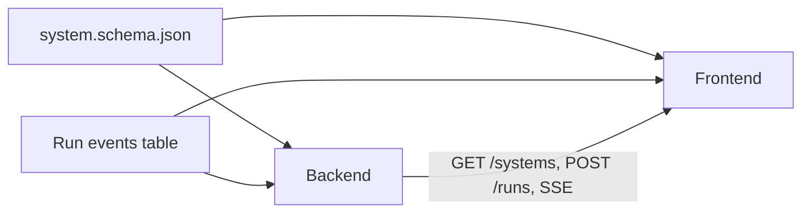
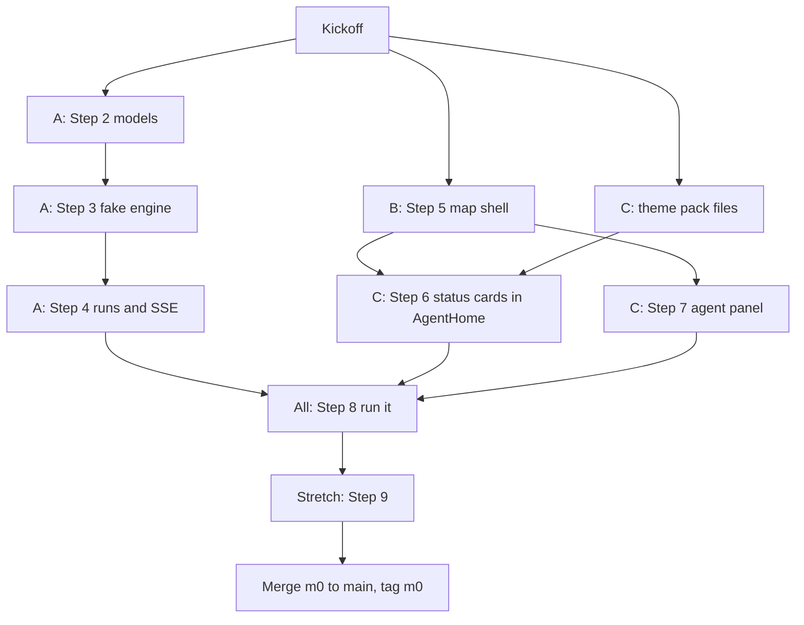

# M0 team plan (3 people)

Goal (from [docs/ROADMAP.md](docs/ROADMAP.md)): open Hello Tubes, press Run, and watch the overseer plan, travelers walk the lines and progress bars fill. No AI, no API key. The step prompts are in [docs/M0-prompts.md](docs/M0-prompts.md). Steps 0 and 1 are already done.

One thing differs from the docs: `M0-prompts.md` is written for one person working through steps in order. This plan keeps the same steps and checks, but splits Steps 6 and 8 across people. Nothing in the architecture changes.

## Workflow

- `main` holds only finished milestones. Everyone works on `m0`.
- Branch names: `m0/step-2-models`, `m0/map-shell`, `m0/theme-tuberian`, and so on.
- Each pull request goes into `m0`, gets reviewed by one other person, and must pass that step's **Check** from `M0-prompts.md`. The reviewer also asks the step's "Explain it" question.
- Use one fresh Cursor chat per step. Use Plan mode for Steps 3, 5 and 8.
- At the end: merge `m0` into `main`, `git tag m0`, then push the tags.

## Contracts (change only with all three agreeing)

These are what let three people work at once without blocking each other:

- [spec/system.schema.json](spec/system.schema.json): the shape of a system. The backend models and the frontend `types.ts` both copy it.
- The run events table in [docs/ARCHITECTURE.md](docs/ARCHITECTURE.md) (`run.started`, `agent.status`, `message.sent`...): what the backend sends and the map draws.
- Map rule: one edge per spec line, house to house, never merged roads.

## The three tracks (assign names later)

Each track owns its own folders, so merge conflicts stay rare.

- **Track A, Backend (Python):** owns `backend/`
  - Step 2: `backend/app/models.py` and `GET /systems/{id}`. Small; merge it first, since the frontend needs it.
  - Step 3: `backend/app/engine/`, `backend/app/runners/`, `backend/scripts/try_run.py`
  - Step 4: `POST /runs` and `GET /runs/{id}/events` (SSE)
  - Step 8: `frontend/src/run/useRun.ts` (A knows the events best)
  - Step 9: `GET /systems` list
- **Track B, Map (React):** owns `frontend/src/map/`, `frontend/src/shell/`, `frontend/src/spec/types.ts`, `frontend/src/api.ts`, `App.tsx`
  - Step 5: Vite scaffold, shell (sidebar, top bar), `Map.tsx`, `AgentHome.tsx` (plain), `PathEdge.tsx`
  - Step 8: `Traveler.tsx`, merging run state into node data, road highlight, blocked flash, Run button
  - Step 9: preset picker in the top bar
- **Track C, Look and panel (React and CSS):** owns `frontend/src/themes/`, `frontend/src/panel/`
  - Step 6: `themes/types.ts`, `themes/tuberian.ts`, `ThemeProvider.tsx`, then the status card and badges inside `AgentHome.tsx`, once B's Step 5 is merged
  - Step 7: `panel/AgentPanel.tsx`
  - Step 8: badge glow, result card next to You, work history in the panel
  - Step 9: `themes/swamp.ts` and a theme switcher

The one shared file is `AgentHome.tsx`: B creates it in Step 5 and C changes it in Step 6. Never edit it on two branches at once.

## Order of work

- **Phase 1, all in parallel:** A does Step 2. B scaffolds Vite and builds Step 5, using `presets/hello-tubes.json` as stand-in data until Step 2 lands. C builds the theme pack files, which don't depend on the map.
- **Phase 2:** A does Steps 3 and 4. C does Step 6 (after Step 5 merges) and Step 7. B helps review and polishes the map.
- **Phase 3:** Step 8, together. Agree on the shape `useRun.ts` returns before starting: `{ start, runStatus, agents, travelers, events }`.
- **Phase 4:** Step 9 stretch, then tag `m0`.

## Kickoff (I can do this once you confirm)

1. Commit the "web, not roads" doc edits (`docs/VISION.md`, `docs/ARCHITECTURE.md`, `docs/THEMES.md`, `.cursor/rules/tuberium.mdc`).
2. Push `main`. It's 2 commits ahead of GitHub.
3. Create and push the `m0` branch.
4. You, on GitHub: add the two collaborators (Settings, then Collaborators). Then add a rule on `m0` requiring one approving review on pull requests.
5. Each teammate, once: clone, `copy backend\.env.example backend\.env`, install Python deps (`uv venv` and `uv pip install -r backend/requirements.txt jsonschema pre-commit`, or pip), `pre-commit install`, `python spec/validate.py` (9 files should report `ok`). B and C also need Node 20 or newer.

## How we know M0 is done

Step 8's check passes on a fresh clone: press Run, the road lights up, a critter walks to the Researcher, its progress bar fills while its web badge glows, a file moves down the one-way line to the Writer, and the result appears next to You.